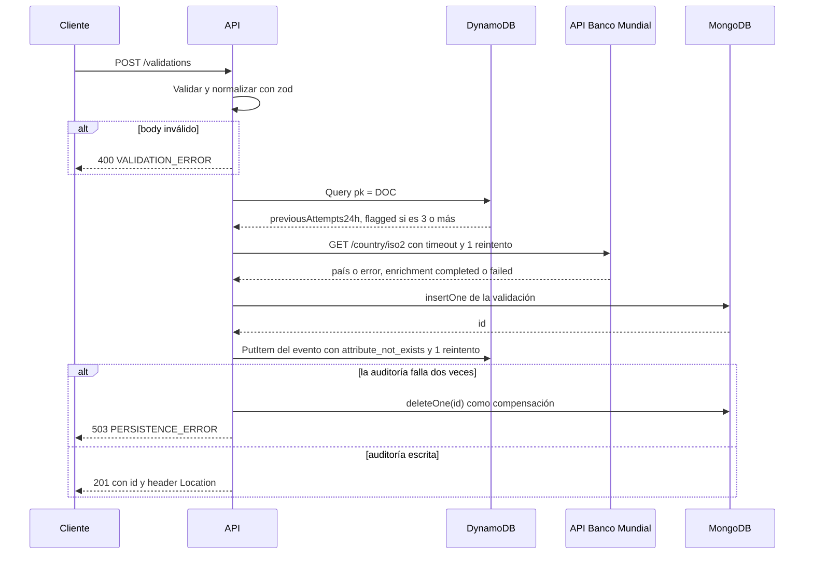

# AUCO Validations

[](https://github.com/OWNER/REPO/actions/workflows/ci.yml)

Servicio en Node.js que registra validaciones de identidad (nombre y documento), las enriquece con datos del país consultando una API pública, las guarda en MongoDB y escribe un evento de auditoría en DynamoDB.
Además calcula una señal de riesgo: cuántas veces se intentó validar el mismo documento en las últimas 24 horas.

## Requisitos

- Node.js 22 o superior
- Docker (solo para MongoDB y DynamoDB Local; la app corre con npm)

## Cómo correrlo

```bash
cp .env.example .env
docker compose up -d
npm install
npm run db:setup   # crea la tabla de auditoría (idempotente)
npm run dev        # http://localhost:3000
```

Las credenciales `AWS_ACCESS_KEY_ID`/`AWS_SECRET_ACCESS_KEY` del `.env` son dummy, pero obligatorias: sin ellas DynamoDB Local falla con un error confuso. DynamoDB Local corre en memoria, así que si reinicias el contenedor debes volver a ejecutar `npm run db:setup`.

## Ejemplos

Todos los casos (válidos, inválidos, riesgo, 400 y 404) están listos en [`requests.http`](requests.http) para la extensión REST Client de VS Code o el cliente HTTP de JetBrains.

**POST válido** (201, con header `Location: /validations/{id}`):

```bash
curl -i -X POST http://localhost:3000/validations \
  -H 'content-type: application/json' \
  -d '{"name":"José Pérez","documentNumber":"1.234.567","country":"CO"}'
```

```json
{ "id": "6b01111ed9073c3371852781" }
```

**POST inválido** (400):

```bash
curl -X POST http://localhost:3000/validations \
  -H 'content-type: application/json' \
  -d '{"name":"","documentNumber":"12ab","country":"COL"}'
```

```json
{
  "error": {
    "code": "VALIDATION_ERROR",
    "message": "El cuerpo de la solicitud es inválido",
    "details": [
      { "path": "name", "message": "Debe tener al menos 3 caracteres" },
      { "path": "documentNumber", "message": "Debe tener entre 6 y 10 dígitos" },
      { "path": "country", "message": "Debe ser un código ISO 3166-1 alpha-2 de dos letras" }
    ]
  }
}
```

**GET** (200; 404 si no existe, 400 si el id no tiene 24 caracteres hexadecimales):

```bash
curl http://localhost:3000/validations/6b01111ed9073c3371852781
```

```json
{
  "id": "6b01111ed9073c3371852781",
  "name": "José Pérez",
  "documentNumber": "1234567",
  "country": "CO",
  "enrichment": {
    "status": "completed",
    "country": {
      "name": "Colombia",
      "region": "Latin America & Caribbean",
      "capital": "Bogota",
      "incomeLevel": "Upper middle income"
    }
  },
  "risk": { "previousAttempts24h": 0, "flagged": false },
  "createdAt": "2026-11-21T03:33:50.431Z"
}
```

Reglas de entrada: `name` se recorta y se colapsan espacios (3 a 100 caracteres, solo letras, espacios, apóstrofo y guion); `documentNumber` se normaliza quitando puntos, espacios y guiones (6 a 10 dígitos). `country` es un **campo opcional añadido** para tener algo concreto que enriquecer: código ISO 3166-1 alpha-2, se pasa a mayúsculas y por defecto es `CO`.

Todos los errores tienen la forma `{ error: { code, message, details? } }`, con `code` en `VALIDATION_ERROR`, `NOT_FOUND`, `INVALID_ID`, `PERSISTENCE_ERROR` o `INTERNAL_ERROR`.

## Pruebas

```bash
npm test
```

No necesitan Docker ni red: `createApp` recibe las dependencias, y las pruebas le inyectan repositorios en memoria y un cliente de países fake. El cliente HTTP se prueba con un `fetch` stub. GitHub Actions corre lint, pruebas y build en cada push ([`.github/workflows/ci.yml`](.github/workflows/ci.yml)).

## Flujo de POST /validations



## Señal de riesgo

Antes de crear la validación se hace un `Query` a la tabla de auditoría por `pk = DOC#{documento}` con `sk BETWEEN {hace 24 h} AND {ahora}` y `Select: COUNT`. El resultado se guarda en el registro como `risk: { previousAttempts24h, flagged }`, donde `flagged` es `true` desde el tercer intento previo. Varios intentos con el mismo documento en poco tiempo son una señal típica de fraude (prueba de identidades robadas, insistencia tras un rechazo), y esta consulta es justo el patrón de acceso para el que se diseñaron las llaves. La validación no se bloquea: se marca para que el negocio decida. Si Dynamo no responde, se devuelve 503 antes de escribir nada, porque sin Dynamo tampoco se podría auditar.

## Decisiones de diseño

**Llaves de DynamoDB:** `pk = DOC#{documento}` y `sk = {createdAt ISO 8601 UTC}#{validationId}`. El patrón de acceso es "historial de un documento en un rango de fechas" (`Query` por `pk` con `sk BETWEEN`). ISO 8601 ordena cronológicamente como texto, y el sufijo `validationId` evita colisiones si dos eventos del mismo documento caen en el mismo milisegundo. El `PutItem` usa `attribute_not_exists(pk)` para que un evento nunca se sobrescriba.

| Decisión                                                       | Alternativa descartada                  | Por qué                                                                                                                                                                                 |
| -------------------------------------------------------------- | --------------------------------------- | --------------------------------------------------------------------------------------------------------------------------------------------------------------------------------------- |
| Express 5 con inyección manual de dependencias                 | NestJS                                  | Dos endpoints no justifican un framework con DI; Express queda más cerca de un handler de Lambda y propaga errores async sin wrappers.                                                  |
| API del Banco Mundial                                          | restcountries                           | La v3.1 fue retirada (responde siempre un error de deprecación) y la v5 exige API key; el Banco Mundial es gratuito, sin registro, y aporta nombre, región, capital y nivel de ingreso. |
| Si la API externa falla, crear con `enrichment.status: failed` | Responder 502                           | La caída de un tercero no debe bloquear el negocio. Timeout y un reintento (300 ms) solo ante red, timeout, 5xx o 429.                                                                  |
| Compensación: borrar en Mongo si la auditoría falla dos veces  | Transacción distribuida o patrón outbox | No hay transacción entre Mongo y Dynamo; la compensación garantiza que nunca quede una validación sin auditoría, sin agregar colas ni workers.                                          |
| `sk = {ISO}#{validationId}`                                    | `sk` con solo la fecha del día          | Con solo la fecha, dos eventos del mismo documento en el mismo día se sobrescribirían en el `PutItem`.                                                                                  |
| Query por `pk` sin GSI                                         | GSI por fecha o single table design     | El único patrón de acceso es por documento; un GSI sería costo sin consulta que lo use.                                                                                                 |
| No guardar el nombre en la auditoría ni en los logs            | Auditar el registro completo            | Minimización de datos personales: la auditoría solo guarda lo necesario para el patrón de acceso, y los logs solo registran método, ruta, status y duración.                            |

## Verificar la auditoría

Con la app corriendo y después de crear una validación con el documento `1.234.567`:

```bash
AWS_ACCESS_KEY_ID=local AWS_SECRET_ACCESS_KEY=local \
aws dynamodb query \
  --endpoint-url http://localhost:8000 --region us-east-1 \
  --table-name validation_audit \
  --key-condition-expression 'pk = :pk AND sk BETWEEN :from AND :to' \
  --expression-attribute-values '{":pk":{"S":"DOC#1234567"},":from":{"S":"2026-01-01"},":to":{"S":"2099-12-31"}}'
```

## Respuestas de la entrega
